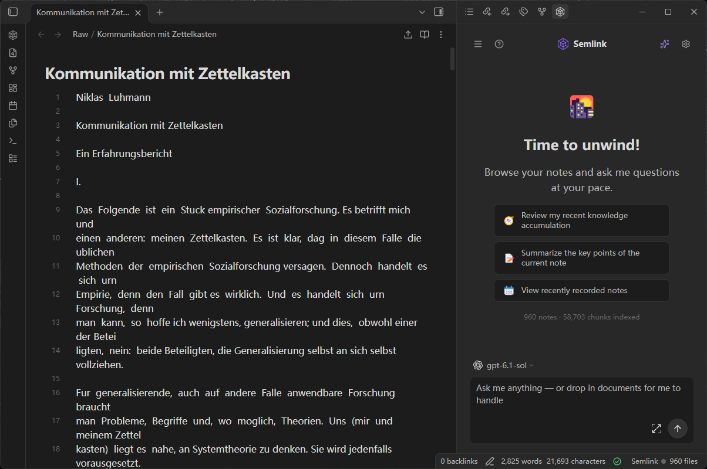

# Semlink — AI chat and semantic search

**Put your notes to work.**

**AI chat and semantic search for the research, writing, and projects already in your vault.**

You have collected the material. Now you need to use it: pick up a project, prepare an outline, or find an idea you remember reading. Semlink searches and reads your notes inside Obsidian, helping you bring relevant context into the task without collecting and pasting every note by hand.

**Start with a real task:** “I'm writing about onboarding. Find relevant ideas in my reading notes and project reviews, then help me build an outline with sources.”

## From scattered notes to a useful next step

### Find the idea, even when you forget the words

Search your vault by meaning with semantic search, or use keyword and pattern search when you know what to look for. Rediscover related notes and passages without remembering the exact title or folder.

### Pick up the work where you left off

Ask about an existing project, compare ideas across notes, or gather material for your next draft. Drag specific notes into chat when you want to provide focused context. The built-in assistant can search and read additional material while answering.

Try: “From these project notes, summarize the decisions, their reasons, and the questions still open.”

### Turn reading into something you can use

Bring your reading notes together around a question. Ask for a comparison, an outline, or a summary to develop in your own words. Open numbered citations to check the source passages, then save a useful answer back as a note.

Try: “Compare the approaches to habit formation in my notes. Where do they agree, and where do they differ?”

AI answers can miss context or make mistakes. Citations help you review the underlying material; they are not a guarantee of correctness or complete coverage.

## One sidebar, with your choice of AI

- **Built-in AI chat:** search, note reading, and answers run through the plugin's own assistant. No separate Claude Desktop, coding agent, or terminal is required for this workflow.
- **Bring your own provider:** configure a chat model and an embedding model. Use supported cloud providers or connect local models through runtimes such as Ollama. Local runtimes require their own installation and suitable hardware.
- **Keep your index local:** the search index stays on your device. Indexing picks up note changes so you can work with your evolving vault.
- **See the work:** inspect the available tool activity and source notes while the assistant works.

## Already work in Claude, Codex, or Cursor?

Semlink also includes a local **MCP server**. Compatible AI clients can search and read your vault through Semlink's tools, so your existing notes can provide context in the AI workflow you already use.

MCP is optional. You do not need to configure an external client to use Semlink's built-in chat. External clients need their own MCP configuration and model access.

## Share a useful answer

Share a conversation as a read-only page with a link or QR code on your **local network**. The recipient can read it in a browser without installing Obsidian. Stop sharing to revoke access. Review the conversation and sources before sharing private material.

## Get to your first useful answer

1. **Install and enable Semlink** from Community plugins in the desktop version of Obsidian.
2. **Configure chat and embeddings.** Choose providers in the setup guide and supply API keys where required, or connect compatible local endpoints. Let the relevant notes finish indexing.
3. **Bring a task.** Attach a project note or ask about a topic in your vault. Review the sources and save the result you want to keep.

Start with a familiar project so you can judge whether the retrieved notes and answer are useful. Setup time and indexing speed depend on your vault, provider, and device.

## Free core, optional Pro

**Search, AI chat, indexing, and MCP are free core features.** The optional one-time Pro license unlocks unlimited chat history and history management, including search, pinning, and folders. Check the [current feature comparison](https://getsemlink.com/#pricing) before purchasing.

Model usage is separate: cloud providers may charge for chat and embeddings. Semlink does not include model credits. Local models use your own computing resources.

## Privacy and compatibility

- **Desktop only:** Semlink currently supports desktop Obsidian, not mobile.
- **Local index does not mean all processing is local.** Configured cloud embedding services receive text needed for indexing, and cloud chat services receive prompts and included note context.
- **Local model option:** use local chat and embedding endpoints when you want those model requests processed on your own device. Check any external AI client's configuration separately.
- **Your files remain in Obsidian:** you do not need to migrate your vault into a separate hosted knowledge base.

Read the [privacy policy](https://getsemlink.com/privacy.html) for the distinction between model requests, license services, and website data.

## Languages

**English** | [简体中文](README_CN.md) | [繁體中文](README_zh-Hant.md) | [日本語](README_ja.md) | [한국어](README_ko.md) | [Deutsch](README_de.md) | [Français](README_fr.md) | [Español](README_es.md) | [Português](README_pt.md) | [Italiano](README_it.md) | [Русский](README_ru.md)

## Help and feedback

[Getting started and documentation](https://docs.getsemlink.com/) · [Report a problem or request a feature](https://github.com/ouou365/Semlink/issues) · [Website and Pro comparison](https://getsemlink.com/)

When reporting a search problem, include the question, the result you expected, the plugin version, and whether the relevant notes finished indexing. Remove private note content and API keys before sharing.

Semlink is open source under the [MIT license](https://github.com/ouou365/Semlink/blob/HEAD/LICENSE).
