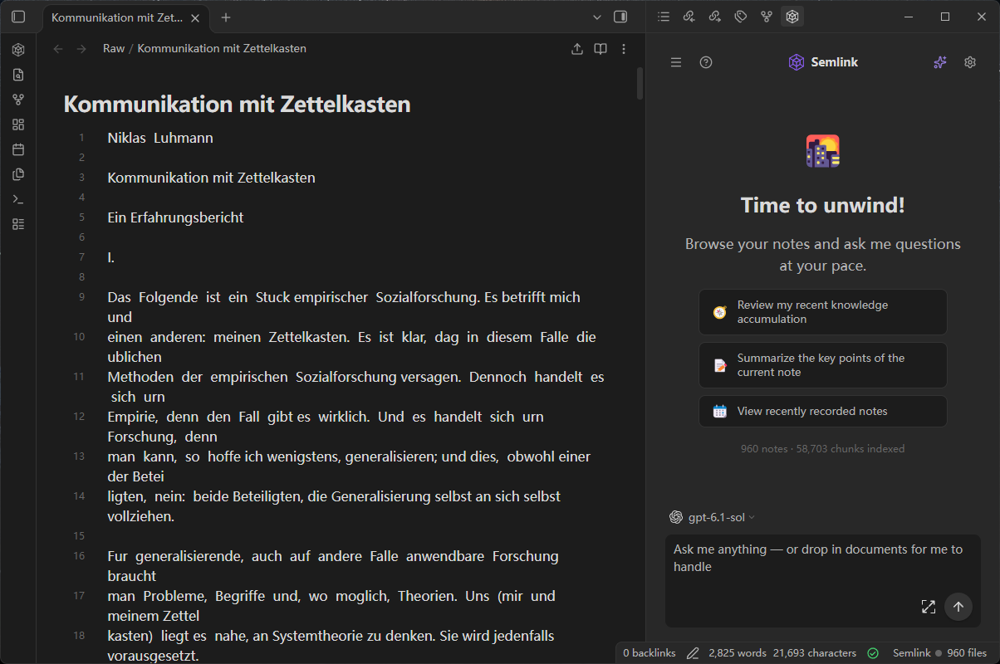

# 🧠 Semlink — 智能体知识工作区（Agentic Knowledge Workspace）

**让你的 Obsidian 知识库思考、协作、行动。**

**简体中文** | [English](README.md) | [繁體中文](README_zh-Hant.md) | [日本語](README_ja.md) | [한국어](README_ko.md) | [Deutsch](README_de.md) | [Français](README_fr.md) | [Español](README_es.md) | [Português](README_pt.md) | [Italiano](README_it.md) | [Русский](README_ru.md)

Semlink 把你的 Obsidian 知识库变成一个智能体知识工作区——一个住在侧边栏的 AI 助手：检索你写过的每一个字，用真正的工具推理，每一条结论都引用回你的笔记，并能一键分享它的所得。完整的智能体就内置在插件里：不需要 Claude Desktop、不需要 Cursor、不需要终端、不需要安装任何第三方客户端。带上你自己的 API Key，你的知识库就开始思考。




## 🤔 为什么是 Semlink？

你写了很多年。然后想问一个关于自己知识的问题——流程却变成：回忆在哪个文件夹、Ctrl+F、复制粘贴进聊天窗口、丢失上下文。

多数 Obsidian AI 插件依赖第三方智能体客户端——而那些客户端是为编程设计的智能体应用。你得到的是一个顺路看看笔记的编程助手，而不是一个真正工作在知识库里的智能体。

Semlink 反着来：

**工作区就是知识库，智能体是内置的——不是外挂。** 装上插件、贴入 key、开始提问。智能体思考、调用工具、读你的笔记、给出带编号引用的回答——全程都在 Obsidian 里。你不必相信这个回答，你看着它产生，然后检验它。

### Semlink vs. Copilot for Obsidian

| | Semlink | Copilot for Obsidian |
|---|---|---|
| 零外部工具 | ✅ Agent、RAG、分享全部内置插件 | ❌ Agent 需另装 opencode，RAG 需另装 Miyo |
| 智能体循环（检索→读→推理） | ✅ 9 个工具，模型自主决定读什么 | 🟡 经外部客户端执行 |
| 推理透明 | ✅ 思考 + 工具轨迹，在插件内实时流出 | 🟡 循环发生在 Obsidian 之外 |
| 引用 | ✅ 每轮统一编号；点击引用直达来源笔记出处 | 🟡 列出来源笔记 |
| 分享回答 | ✅ 局域网网页 + 二维码，随时撤销 | ❌ 复制粘贴 |
| 其他 AI 能读你的库（MCP） | ✅ 内置本地服务 | ❌ |

### 有意为之的设计

🧠 **智能体是常住民，不是访客。** 智能体需要的一切——检索、工具、思考轨迹、引用、分享——都在插件里。外部 AI 客户端可以通过 MCP 进来，但那是可选加分项，绝非前提。

🗄️ **本地优先，是结构使然。** 索引就是你磁盘上的一个 SQLite 文件。Semlink 没有服务器——不是"我们承诺不上传"，而是根本没有可以上传的地方。

🔑 **BYOK，且不必瞎猜。** 24 家对话厂商目录（1,800+ 模型，带价格与上下文窗口）加上专门的嵌入供应商目录，几下点击完成配置；Ollama 这类本地运行时连 key 都不用。Semlink 不加价、不经手 token——你的供应商直接向你计费。

🪟 **库的原住民。** 把笔记拖进对话即可附加，回答一键存回笔记，上下文用量环实时可见。你打字时索引主动让路。工作区就在你笔记已经在的地方——无需导出，无需同步。

## ✨ 特色功能

### 🔗 真正跟得上的引用

每一轮问答运行一个统一的编号注册表，贯穿思考轨迹、答案正文和来源卡片——答案里的 `[3]` 就是你刚才看着模型读过的那个 `[3]`。点击引用，Obsidian 直接打开它来源的那条笔记、定位到出处。一个回答的好坏，取决于你能不能拿笔记核对它——那就核对。

### 📡 不导出任何东西，直接分享回答

发现了值得展示的东西？一键把整场问答——问题、思考轨迹、回答、来源卡片——发布成局域网里的一个干净网页。发链接或二维码，对方在任意浏览器打开：不需要 Obsidian、不需要账号、不需要安装。停止分享，页面即刻下线。任何东西都不会离开你的网络。

### 🪟 实时看着智能体干活

回答不是唯一的产出——推理过程也是。思考实时流出，每一次工具调用（`search_notes` → `get_section` → …）连同结果全部留痕，上下文用量环显示模型窗口的占用，旁边还有缓存命中率。模型看到过什么，你就看到什么——这正是全部意义所在。

## 🚀 快速上手

1. **安装** — 在 Obsidian 的 设置 → 第三方插件 中搜索 "Semlink" 一键安装，或直接打开[插件页面](https://community.obsidian.md/plugins/semlink)安装。
2. **配置** — 从目录选择供应商（或粘贴自定义端点）并填入 API key。三步引导会校验对话 + 嵌入配置并开始索引。
3. **提问。** 打开侧边栏："关于卡片盒笔记法我都写过什么？"——然后看：思考 → `search_notes` → `get_note` → 带 [1][2][3] 的回答。

就这样。不需要 Agent 客户端，不需要服务器。你的笔记永远不会被修改——Semlink 只读取。

## 🧠 思考——展示工作过程的智能体

- **九个内置工具**，回答时由模型自主决定取用什么：语义搜索、读笔记、读章节、相似笔记、正则 grep、带时间戳的索引列表、当前笔记感知。它不会检索三个片段就硬编：它先搜索、读对章节，并展示每一步。
- **可检验的思考。** 每个回答都附带模型的推理和每一次工具调用（`search_notes` → `get_section` → …），实时流出——不是自信的黑盒。
- **经得起核对的引用。** 每轮一个统一编号注册表，贯穿思考轨迹、答案正文和来源卡片；点击引用直达它来自的那条笔记（和那一行）。
- **触达全部笔记的搜索**：一句自然语言按含义查询你写过的每一条笔记；当你确实知道确切字串时，还有相似笔记推荐和正则 grep。

## 🤝 协作——知识按你的条件走出孤岛

- **局域网分享对话**：一键把问答发布成一个干净的网页——发链接或二维码，对方在任意浏览器打开，你随时可停止分享。一切都在你的网络里。
- **回答变成笔记**：任何回答一键存回知识库。
- **拖拽即附加**：把笔记拖到面板任意位置——`[[双链]]` 内联解析——智能体会优先读它。
- **可选：放你的其他 AI 进来。** 同样的工具同时以本地 MCP 服务暴露，Claude Desktop、Claude Code 和 Cursor 也能检索并引用你的库。纯属可选——内置智能体不需要帮手。

## ⚡ 行动——实时掌控

- **RAG 仪表盘，不是进度条**：Vault 指标、真实的逐笔记嵌入进度，索引/自动嵌入开关即时生效——运行中途也能切换。
- **换配置不用仪式感**：更换嵌入模型会自动触发全量重索引；引导会重新校验 key 并把你带到正确的步骤。
- **实时索引**随写随嵌入，捕获每一次文件变更——你工作时索引主动让路，编辑器绝不卡顿。
- **命令面板**统管索引、MCP、调试日志与进度。

## 🔑 BYOK — 自带 Key

任何 OpenAI 兼容或 Anthropic 兼容端点都可用——DeepSeek、GLM、SiliconFlow、OpenAI、Anthropic、OpenRouter、Ollama、LM Studio，以及内置目录里的 1,800+ 更多模型。关键是：

- **对话模型**：从带价格与上下文窗口的目录中挑选，或添加自定义端点（包括免 key 的本地运行时）
- **嵌入模型**：专门的嵌入供应商目录——SiliconFlow BGE-M3 预置；Jina、Voyage、Nomic、Mixedbread 等可选，或用免 key 的本地嵌入端点
- **你的 key、你的费率、随意切换**——模型用量由你的供应商计费；Semlink 从不经手一分钱

## 🌐 MCP — 可选，为你的其他 AI 准备

内置智能体自身就是完整的。如果你也在用 Claude Desktop、Claude Code 或 Cursor，同样的工具会以本地 MCP 服务暴露：

```json
{ "mcpServers": { "semlink": { "type": "http", "url": "http://127.0.0.1:3001/mcp" } } }
```

仅监听本机，可选访问密钥。无云端中转。

## ❓ 常见问题

**需要 Claude Desktop、Cursor 或其他 AI 客户端吗？**
不需要。完整智能体——思考轨迹、工具调用、引用、分享——全在插件内运行。MCP 的存在是为了让外部 AI **也能**读你的库，绝不是因为它们必须参与。

**我的数据会被发送到哪里？**
索引在你的插件文件夹 `data/` 下，位于你的磁盘。仅有的网络请求都发向你配置的供应商；局域网分享也只发生在你自己的网络里。详见[隐私政策](https://getsemlink.com/privacy.html)。

**和 Copilot for Obsidian 有什么区别？**
Copilot 的 Agent 走外部的 opencode、RAG 走外部的 Miyo——都是要额外安装运行的外部工具。Semlink 把整个循环留在 Obsidian 里：你看到思考和每一次工具调用，模型自己决定读哪些笔记，回答引用可以打开的具体笔记。如果 Copilot 够用，留着它——Semlink 是给想要一个工作区、而不是更多客户端的人准备的。

**需要 API key 吗？**
Semlink 设计上就是 BYOK——但"自己的 key"也包括 Ollama 这类免 key 的本地运行时（对话和嵌入都行）。云端免费额度（SiliconFlow、Groq…）也完全够用。

**索引存在哪里？**
插件文件夹内的 `data/vault.db`（SQLite）和 `data/vectors.bin`。随时可删可重建；任何东西都不会离开你的电脑。

**该用哪个模型？**
任意你喜欢的长上下文对话模型——回答会大段引用笔记。嵌入很便宜也不频繁（BGE-M3）。

## 📜 许可证

MIT — 见 [LICENSE](LICENSE)。可选的 Pro 许可证为一次性买断，绝非订阅。
